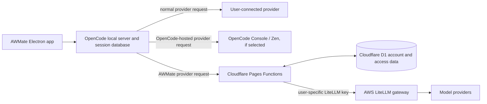

# AWMate backend separation and usage tracking

Reviewed: 2026-11-10

This note describes the two independent AI request paths in AWMate, what each backend owns, and where per-user usage can be measured. The word “backend” is used here for the application/session backend and the inference gateways; they have different jobs.

## The short version

AWMate uses the OpenCode application and its local server/session storage. Separately, AWMate offers an optional NxtGenSec model gateway that runs through Cloudflare and LiteLLM on AWS.

These paths are separate. Signing in to AWMate is required to enter the AWMate desktop app, but it does not send every model request through NxtGenSec. A request goes through the provider selected for that request:

- A user's normal provider connection goes through that provider's configured endpoint.
- An OpenCode Console/Zen connection goes through OpenCode's hosted service and is measured there.
- The AWMate provider goes through `awmate.nxtgensec.org` and then the AWS LiteLLM gateway.

## What each service is responsible for

| Service | Responsibility | What it stores or measures |
| --- | --- | --- |
| OpenCode local server | Runs sessions, connects to whichever provider the user selected, and stores session history/usage for that local server. | Local projects, sessions, messages, provider/model details, token usage, and calculated/reported cost. |
| OpenCode Console/Zen (optional) | OpenCode's separate hosted provider/workspace service, if a user chooses it. | OpenCode Console can report workspace and member usage for requests sent through that service. It does not send those numbers to AWMate's website automatically. |
| Cloudflare Pages Functions | AWMate web authentication, desktop-session validation, account approval, admin operations, and the AWMate gateway proxy. | Runs the platform API. It validates AWMate access and forwards eligible AWMate requests to LiteLLM. |
| Cloudflare D1 | AWMate platform database. | Google account identity, desktop approval, AWMate-to-LiteLLM user mapping, gateway enablement, allowed models, limits, encrypted LiteLLM key material, and hashed AWMate sessions. It is not currently the per-request token ledger. |
| AWS LiteLLM | NxtGenSec's model gateway and metering point. | LiteLLM user/key budgets and limits, request spend, and usage/token fields in its spend/activity records, subject to its logging, version, and upstream usage data. |
| Model provider | Supplies the actual model response. | Provider-side billing and any provider-specific usage records. |

## Request flows

### 1. Normal OpenCode provider path

1. A user selects a provider in the OpenCode UI and connects their own account/key, or selects another configured provider.
2. The local OpenCode server sends that request to the selected provider endpoint.
3. OpenCode records the session and the usage returned by the provider (or derives cost from the model pricing data when appropriate).
4. Those session records live in that OpenCode server's local data/database. The desktop app does not upload them to the AWMate platform as part of AWMate Google sign-in.

This means the user can inspect session/model totals locally (for example with `opencode stats` or the local session statistics API). It does not mean an AWMate administrator can see every user's local database.

### 2. OpenCode Console/Zen path, when a user chooses it

OpenCode Console/Zen is an optional OpenCode-hosted service, separate from NxtGenSec LiteLLM. Requests explicitly sent through an OpenCode workspace can be measured by that workspace. The OpenCode Console documentation describes member-level usage and administrator workspace views, including requests, tokens, and spending. These reports belong to OpenCode Console; AWMate does not currently import them.

If a user connects a provider using their own key through OpenCode Console, OpenCode says the provider bills that key directly while Console still records request/cost data for usage and budgets. Provider billing and Console's measured cost should therefore be treated as separate figures.

### 3. AWMate / NxtGenSec gateway path

1. The user signs in to AWMate with Google. The platform issues a desktop session after checking approval.
2. Electron stores the AWMate session token using OS-backed secure storage. It does not receive the LiteLLM master key or the user's raw LiteLLM gateway key.
3. The desktop app exposes the AWMate models assigned to that account. When the user selects one, the request goes to the Cloudflare route under `https://awmate.nxtgensec.org/api/gateway/v1/...`.
4. Cloudflare validates the desktop session and checks desktop approval, gateway enablement, provisioning, and the account's model access.
5. Cloudflare decrypts that account's LiteLLM key server-side and forwards the request to the AWS LiteLLM gateway.
6. LiteLLM routes the request to the model provider, enforces its configured user/key limits, and records available spend/token usage.

For desktop OAuth return, packaged AWMate uses `awmate://auth/complete`. An unbundled development build uses the separate `awmate-local://auth/complete` scheme to avoid competing with an installed AWMate copy. The platform allows only these fixed schemes and carries the selection in signed OAuth state. The callback URL contains no session token; the initiating desktop instance receives the session through its own poll.

Each AWMate account has a LiteLLM `gateway_user_id` in D1. The platform creates or updates a LiteLLM user and a user-owned key for that identity. Requests use that key, which is how LiteLLM associates usage with the AWMate account. The platform does not send the LiteLLM master key to Electron or to the browser.

## Can we see each user's token totals?

### NxtGenSec LiteLLM: yes, the gateway can record them; the AWMate portal currently shows spend only

LiteLLM's spend/activity records include prompt/input, completion/output, and total-token fields when usage is available. Its documented daily activity and spend-report APIs can return token totals and model breakdowns. Because every AWMate account maps to its own LiteLLM user/key, those records can be queried per AWMate user from the platform using its server-side LiteLLM credentials.

Current AWMate platform behavior is narrower:

- `functions/api/account.ts` calls LiteLLM `/user/info` and returns the usage object.
- `functions/api/admin/accounts.ts` calls `/user/info` for each provisioned account.
- `src/components/AccountPortal.tsx` displays the dollar `spend` field for the account and admin list.
- The current AWMate portal type/UI does not request or display token totals.

So **today, the website shows per-user gateway spend, not a per-user token count**. Token totals are available from the LiteLLM metering layer and can be added to the AWMate account/admin views through a Cloudflare Function that queries LiteLLM server-side. The LiteLLM master key must remain in Cloudflare secrets; it should never be returned to the browser or desktop app.

The exact report endpoint and parameters should be checked against the deployed LiteLLM version's own `/docs` before implementation. LiteLLM documents token fields on spend logs and daily activity; the AWS installation's version, retention, database, and logging settings determine which reports are enabled and how far back they go.

### OpenCode: yes locally, and through OpenCode Console for Console-routed team requests; no central AWMate report today

- The local OpenCode server records token usage per session/model and has local statistics. These are tied to that server's database, not to the Google account in AWMate D1.
- If requests go through an OpenCode Console workspace, Console can show member-level usage for those Console-routed requests. This remains in OpenCode Console and is not combined with LiteLLM or the AWMate website.
- If users use their own provider keys directly, OpenCode's local session stats can show the usage it receives, and each provider may also expose its own billing/usage page. AWMate admins do not currently receive those local records.

Therefore, **token counts can exist in both systems, but not in one shared dashboard by default**. The AWMate admin portal can report NxtGenSec LiteLLM usage. OpenCode local statistics and OpenCode Console usage remain separate. Making AWMate show OpenCode/BYOK usage centrally would require a separate, explicit reporting design and a decision about what usage metadata to collect; it is not part of the current gateway integration.

## What we should keep independent

- Keep OpenCode's local server, session database, and user-connected provider routing operating as OpenCode does.
- Keep the NxtGenSec gateway as an optional provider behind the Cloudflare authorization/proxy layer and AWS LiteLLM.
- Do not copy OpenCode sessions, prompts, file contents, or provider secrets into D1 just to show AWMate gateway usage.
- Treat AWMate/LiteLLM usage as the authoritative source for limits and usage billed through NxtGenSec. Treat OpenCode/provider usage as owned by its own database or provider service.
- If a user makes a request through a personal provider or OpenCode Console, that request is outside the NxtGenSec LiteLLM quota unless the selected route actually sends it through LiteLLM.

## Source map in these repositories

### AWMate desktop/OpenCode repository

- `packages/desktop/src/main/service/awmate-auth.ts` — validates AWMate desktop sessions and injects the AWMate provider configuration.
- `packages/desktop/src/main/ipc-handlers/app.ts` — Electron IPC for AWMate sign-in and account status.
- `packages/server/src/handlers/session.ts` — local OpenCode session statistics API handler.
- `packages/protocol/src/groups/session.ts` — declares `/api/experimental/session/stats` and documents it as local session usage aggregation.
- `packages/core/src/session/stats.ts` — aggregates local session/model token and cost records.
- `packages/schema/src/session-stats.ts` — schema for local token/cost statistics.

### AWMate platform repository (`C:\Users\Savir\OneDrive\Desktop\awmate-platform`)

- `functions/api/auth/desktop/*` — desktop login/session lifecycle.
- `functions/api/gateway/[[path]].ts` — validates the AWMate desktop session and proxies requests to LiteLLM with the user's decrypted key.
- `functions/api/account.ts` and `functions/api/admin/accounts.ts` — query LiteLLM user info for current spend display.
- `functions/api/admin/accounts/[id].ts` — provisions or updates the user's LiteLLM user/key, model allowlist, budget, RPM, and TPM limits.
- `functions/_shared/auth.ts` — account/session helpers, key encryption, and server-side LiteLLM management requests.
- `migrations/0001_account_portal.sql` and `migrations/0002_desktop_auth.sql` — account/admin fields and desktop session tables.
- `src/components/AccountPortal.tsx` — website account and admin usage display.

## References

- OpenCode local [CLI statistics](https://docs.opencode.ai/docs/cli/) and [API](https://opencode.ai/docs/api/) reference.
- OpenCode [Console Activity](https://opencode.ai/console/changelog/activity) explains member usage and admin workspace views.
- OpenCode [Console budgets](https://opencode.ai/docs/console/budgets) and [Console providers](https://opencode.ai/docs/console/providers).
- LiteLLM [spend tracking](https://docs.litellm.ai/docs/proxy/cost_tracking) documents per-user spend, token totals, daily activity, and spend logs.
- LiteLLM [customer usage](https://docs.litellm.ai/docs/proxy/customer_usage) describes end-user attribution when a request is tagged as a customer. AWMate currently relies on LiteLLM's internal user/key ownership instead.
