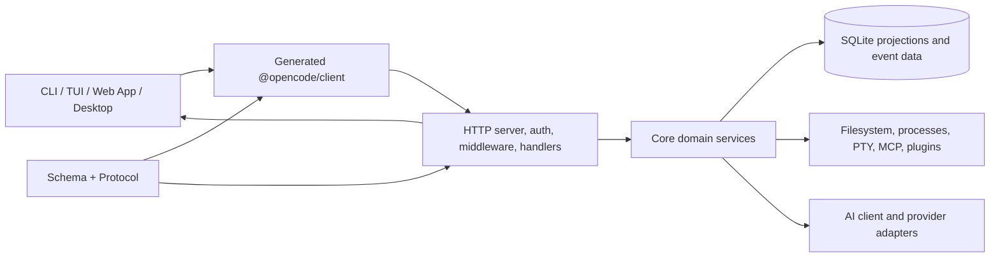
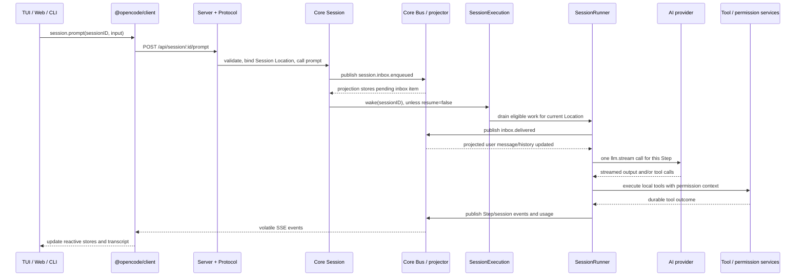

# OpenCode V2 Architecture and AWMate Reference

This is a navigation guide to the OpenCode source currently checked out in AWMate. It records the main module boundaries and one complete request path so future AWMate work can start from the right owners. It is not a substitute for the implementation or the more detailed V2 contracts linked below.

## Snapshot reviewed

- Product source: OpenCode V2, package version `2.2.5`.
- OpenCode base: `anomalyco/opencode`, branch `dev`, base commit `78e066c9d497077ce2f645b1e7e64da1de857a04`.
- AWMate repository: `devnxtgensec/awmate`, currently a fork of `anomalyco/opencode`.
- Repository instructions currently name `dev` as the default/base branch. The local checkout uses `origin` for AWMate and `upstream` for OpenCode. This UI update targets `main` at the user's explicit request; its current push status is recorded in `AWMATE_CHANGELOG.md`.
- The code still carries OpenCode package names, product identifiers, and release assumptions. This guide does not mean those have been rebranded for AWMate.
- Current AWMate UI changes are recorded in `AWMATE_CHANGELOG.md`; the frontend-specific implementation map is in `OPENCODE_FRONTEND_ARCHITECTURE.md`.

When the code changes, inspect the relevant source and update this guide if its map or contracts have gone stale. The current contracts in `specs/v2/` and package `AGENTS.md` files take precedence over summaries here.

## Mental model

The server is the application boundary. Interfaces make typed HTTP requests and consume live events; Server validates/authorizes and dispatches them; Core owns product behavior, durable state, model/tool orchestration, and host capabilities. UI packages mostly consume the generated client rather than importing Core runtime services.

## Package map and ownership

| Area | Owns | Main source |
| --- | --- | --- |
| `@opencode/schema` | Serializable domain shapes, validation schemas, identifiers, public and durable event definitions | `packages/schema/src` |
| `@opencode/protocol` | Typed HTTP operations, route paths, payloads, errors, middleware placement, OpenAPI surface | `packages/protocol/src/api.ts`, `packages/protocol/src/groups` |
| `@opencode/client` | Generated Promise and Effect clients, Solid connection/data stores, service helpers | `packages/client/src` |
| `@opencode/core` | Domain services, session runtime, configuration, persistence, providers, tools, permissions, plugins | `packages/core/src` |
| `@opencode/server` | HTTP server lifecycle, API wiring, auth, middleware, handlers, SSE event feed | `packages/server/src` |
| `@opencode/ai` | Provider-neutral model/message/stream abstractions and provider request adapters | `packages/ai/src` |
| `@opencode/plugin` | Public plugin SDKs for server, TUI, and GUI | `packages/plugin/src` |
| `@opencode/cli` | CLI command parsing, managed/standalone server selection, noninteractive runner, TUI entry | `packages/cli/src` |
| `@opencode/tui` | Terminal UI and its client/data contexts | `packages/tui/src` |
| `@opencode/app` | Shared browser/desktop application UI and server connection runtime | `packages/app/src` |
| `@opencode/desktop` | Electron main process, preload boundary, renderer and native OS integration | `packages/desktop/src` |
| `@opencode/sdk` | Programmatic composition of client, server, Core and provider surfaces | `packages/sdk/src` |
| Supporting workspace packages | Shared UI/theme/utilities, Code Mode, MCP/plugin helpers, services and build tooling | `packages/*`, `services/*` |

The intended dependency direction is Schema → Protocol → Server. Core owns runtime behavior and is downstream of Schema; Client can depend on Schema and Protocol but must not depend on Core or Server. SDK intentionally composes these layers. See root `AGENTS.md` for the enforced boundary rules.

### Core domain map

These domains sit alongside Session and are composed into the Server's service graph:

| Domain | Responsibility | Source area |
| --- | --- | --- |
| Project, workspace, worktree, VCS | Bind directories and workspaces to project identity; manage Git/worktree operations | `packages/core/src/project`, `workspace`, `worktree`, `vcs` |
| Filesystem and execution | File read/write/search, location-specific filesystem drivers, shells, snapshots, formatters, ripgrep | `filesystem`, `environment`, `shell`, `snapshot.ts`, `formatter`, `ripgrep` |
| Config and instructions | Discover and merge config, normalize values, watch reloads, build system instructions and skills | `config`, `instructions`, `instruction-discovery.ts`, `skill` |
| Identity and credentials | Provider auth, saved credentials, OAuth flows, accounts and integrations | `account`, `credential`, `oauth`, `integration` |
| Agents, tools and policy | Agent definitions, tool catalog/execution, permission requests and saved approvals | `agent.ts`, `tool.ts`, `permission.ts`, `permission` |
| Extensions and external services | Plugin lifecycle/hooks, MCP clients/catalogs, web search, references, image and voice | `plugin`, `mcp`, `websearch.ts`, `reference`, `image`, `voice.ts` |
| Background work | Jobs, schedules, persistent PTYs, server/runtime health, usage and activity | `job`, `schedule.ts`, `persistent-pty`, `pty`, `location-activity.ts`, `usage` |
| Persistence and shared infrastructure | SQLite/migrations, KV, event Bus, Effect layer nodes, caches and host adapters | `database`, `event`, `kv`, `effect`, `util` |

Other standalone workspace packages include `@opencode/codemode` (confined execution over schema-described tools), `@opencode/pty` (persistent PTY service), `@opencode/plugin-browser`, `@opencode/plugin-figma`, `@opencode/session-ui` (shared session UI components), `@opencode/stories` (component/story environment), and the site/update/files/stats services. Do not assume that every package under `packages/` is part of the in-process Core runtime.

## Process startup

### CLI and TUI

1. `packages/cli/src/index.ts` initializes the CLI runtime and lazily loads the selected command handler.
2. The default command handler resolves a server through `packages/cli/src/services/server-connection.ts`.
3. It connects to an explicit server, starts/uses the managed background service, or creates a standalone server depending on flags and service configuration.
4. The TUI receives a generated client and server connection, then builds its local data model from `@opencode/client/solid`.
5. Noninteractive `opencode run` also uses the client API: it resolves/creates a Session, admits a prompt, and renders events/results in the terminal.

Useful entry files: `packages/cli/src/index.ts`, `packages/cli/src/commands/handlers/default.ts`, `packages/cli/src/services/server-connection.ts`, `packages/cli/src/run/run.ts`.

### Server

`packages/server/src/process.ts` owns the listening process and application scope. It starts the HTTP listener, builds routes and service layers, then exposes the completed application. `packages/server/src/routes.ts` composes Core global service nodes, location-specific instances, configuration replacements, auth, request middleware, handlers, and `HttpApiBuilder`. `packages/server/src/api.ts` supplies concrete middleware identities to the generic Protocol API.

The same server package has Node and fetch/workerd-oriented entry points (`process.ts`, `fetch.ts`, `workerd.ts`). Keep platform adapters at those edges; domain behavior belongs in Core.

The HTTP path applies authentication, schema/error handling, CORS/compression, and route-specific Location/session middleware. Location middleware creates or selects the service set for a directory/workspace. Session middleware first loads the Session record, then provides its current Location instance to the handler.

## End-to-end Session prompt path

This is the core interaction to understand before changing prompts, tools, model calls, persistence, or live UI updates.

Detailed sequence:

1. `packages/protocol/src/groups/session.ts` defines `session.prompt` at `POST /api/session/:sessionID/prompt`; its payload and response are Schema-owned contracts. The endpoint is marked with Session Location middleware.
2. `packages/server/src/handlers/session.ts` maps the validated request to `Session.Service.prompt` and translates Core errors to public protocol errors. `middleware/session-location.ts` finds the Session and provides the Location-scoped services.
3. Core's public Session facade is `packages/core/src/session.ts`; ID-bound operations are implemented in `packages/core/src/session/session.ts`. Prompt admission checks for prior use of the supplied message ID before preparation, prepares attachments/skills/hooks, then durably admits a user inbox item. Retries with the same identity are idempotent under the rules in `specs/v2/session.md`.
4. Admission publishes `session.inbox.enqueued`. The projector inserts a pending row in `session_inbox`; pending input is not yet part of model-visible transcript history. `resume: false` means admit without scheduling execution; otherwise the Session wakes the process-local execution coordinator.
5. `SessionExecution` is process-global and keyed by Session ID. `SessionRunCoordinator` serializes drains for one Session, coalesces wakeups through a doorbell, and allows different Sessions to execute concurrently. It records a write-ahead claim so a managed server can resume eligible work after a crash/restart; this is not exactly-once execution.
6. At drain start, Core reloads the Session and selects its current `Location` instance. This matters after a Session move: the Session handle retains its ID, while filesystem, provider/model resolution, tools, permissions, and plugins are resolved from the current Location.
7. `SessionRunner` (`packages/core/src/session/runner/llm.ts`) waits for plugin activation, reconciles stale compactions/tool calls, checks the inbox at safe boundaries, and promotes eligible input. Publishing `session.inbox.delivered` removes the pending item and adds the visible user/synthetic message to projected history atomically.
8. Before a Step, the runner reloads history and resolves agent, model, instructions and tools. `SessionModelRequest` assembles the model-visible transcript and request. `SessionStep` makes one explicit `llm.stream` call; it does not run a second in-memory tool loop.
9. Tool calls are associated with the assistant message and durable call ID. Local tools execute through the Core Tool registry with a canonical Session/agent/message/call context; leaves enforce permissions and side-effect rules. Tools can run concurrently, while their terminal durable outcomes are serialized. Code Mode gets validated machine outputs; transcript content and optional metadata have separate roles. See `specs/v2/tools.md` and `packages/core/src/tool/AGENTS.md`.
10. A completed local tool result is projected into history and the runner starts a new Step from reloaded history. Retry, incomplete stream continuation, output limit, and context compaction are explicit policies in `runner/step.ts`, `runner/retry.ts`, `session/compaction.ts`, and `session/model-request.ts`.
11. Execution emits terminal success/failure/interruption events and releases or preserves the restart claim according to the reason. Shutdown interruption preserves eligible claims; user interruption and terminal outcomes release them. `session/execution/restart.ts` handles startup recovery.

For the complete semantics (inbox ordering, retries, instructions, compaction, recovery, durable event replay), read `specs/v2/session.md` before changing Session behavior.

## State, persistence, and events

- Schema declares current contracts and the durable-event manifest. Current Session event definitions live in `packages/schema/src/session-event.ts`; the durable manifest currently combines Session events and selected other domain events.
- Core's `Bus` publishes typed live events, coordinates projectors, and supports ordered per-aggregate durable logs and replay. Session projection logic is in `packages/core/src/session/projector.ts`; read models and history are in `store.ts`, `history.ts`, `message.ts`, and `session/sql.ts`.
- SQLite is accessed through the Effect/Drizzle layer in `packages/core/src/database`. Startup applies migrations. The database contains current projections (Sessions, messages, inbox, claims, etc.); durable log retention is a separate configured concern.
- The Server's `/api/event` feed is volatile across disconnects. `EventFeed` filters and encodes public events once, then offers the same immutable frame to independently bounded per-connection queues (capacity 4,096). A lagging connection is evicted without blocking healthy clients. The HTTP feed spans Locations; clients use event Location metadata to update the right stores.
- Durable replay is separate: `session.log` reads one Session's ordered durable log, with replay/live synchronization semantics. It intentionally does not replay transient text/reasoning/tool-input deltas. UI clients recover authoritative state through API reads and subscriptions rather than treating SSE as permanent storage.
- The current Schema has transitional V1 contracts and migration helpers. New code should use current unversioned contracts, not add dependencies on `schema/src/v1`.

Key files: `packages/core/src/bus.ts`, `packages/core/src/event/sql.ts`, `packages/core/src/database/database.ts`, `packages/core/src/session/projector.ts`, `packages/server/src/event-feed.ts`, `packages/protocol/src/groups/event.ts`, `packages/schema/src/durable-event-manifest.ts`.

## Global and Location-scoped services

Core uses Effect services and layer composition (`LayerNode`) rather than passing a monolithic app object through every function.

- Global/host services include the database, Bus, Session execution coordinator, Session store, jobs, and the Location service selector.
- `LocationServiceMap` maps a normalized `Location.Ref` to a cached service layer. `Instance` provides a Session's current Location services when needed.
- Session execution ownership is process-local/global, but the runner, filesystem, models, tools, permissions, plugin catalog and related project services are Location-scoped.
- A Session move changes placement. Its next drain resolves services at the new Location instead of retaining stale services from the old directory/workspace.
- This design is not clustered execution. Do not infer distributed locking, multi-process fencing, or exactly-once provider/tool effects from the durable execution claim.

See `packages/core/src/instance/service.ts`, `packages/core/src/location-service-map.ts`, `packages/server/src/location.ts`, `packages/server/src/middleware/session-location.ts`, and `specs/v2/session.md`.

## AI providers, tools, permissions, and extensions

- `@opencode/ai` owns provider-neutral request/message/stream contracts and provider adapters. It performs model calls; it does not own Session orchestration, user permissions, or plugin policy.
- Core resolves provider/model choices and credentials. Provider catalog entries can come from Models.dev, explicit config, environment, saved credentials, and built-in provider plugins (`packages/core/src/plugin/provider`). Model policy is applied after configured/catalog providers are assembled.
- Core's `Tool.Service` is Location-scoped. Built-ins, MCP-discovered tools, and plugin tools register one structural tool shape. The registry snapshots advertised definitions and executors for a request; the leaf executes and enforces permission/side-effect policy.
- Permission evaluation combines agent/session rules, saved approvals, and hooks/policy. Hiding a tool from the model catalog is not itself execution authorization.
- The public extension contract is in `packages/plugin`; the runtime supervisor/host and hook activation live in Core (`packages/core/src/plugin`). MCP server lifecycle/catalog is in `packages/core/src/mcp`. GUI-only built-ins live in `packages/gui-plugins`.
- Config and plugin transformations can rebuild provider, MCP, skill, tool and instruction catalogs. Their ownership should stay with the domain that owns those values; avoid adding a parallel registry.

For current tool semantics read `specs/v2/tools.md`; for provider/MCP policy read `specs/v2/provider-policy.md`.

## API and client boundary

The public API chain is deliberately generated:

1. Put serializable public request/response/error/event shapes in Schema when a new shape is needed.
2. Define HTTP route/path/method/schema in Protocol endpoint groups.
3. Implement behavior in Server handlers and call Core domain services.
4. Regenerate OpenAPI/client artifacts through the package scripts. Do not hand-edit generated client code.
5. UI and SDK callers use `@opencode/client`.

`packages/protocol/src/api.ts` assembles groups and middleware into an Effect `HttpApi`. `packages/server/src/routes.ts` provides handlers and concrete middleware. `packages/client` emits Promise and Effect clients plus type shapes; its Solid layer adds `createData` and connection/event state. `packages/sdk` composes these public pieces with local Server/Core capabilities for embedded/programmatic usage.

The TUI uses `packages/tui/src/context/client.tsx` and `context/data.tsx`. The web App creates per-server client/data contexts under `packages/app/src/runtime/server`. Desktop reuses the App renderer, connects it to a desktop-managed local sidecar Server, and can also host plugin servers. Native operations cross `window.electron` through the preload/IPC boundary (`packages/desktop/src/preload`, `src/main`, `src/renderer`). Keep renderer-to-main OS access behind that bridge.

When changing an endpoint, read root `AGENTS.md` and `CONTRIBUTING.md`: update Protocol and Server together, run the client generator from `packages/client`, regenerate the Protocol OpenAPI output as needed, and use the generated-output checks in CI.

## Development, checks, and releases

- Workspace manager: Bun workspaces plus Turborepo. Root scripts are in `package.json`; package-specific scripts are in each package's `package.json`.
- Install and run the V2 CLI/TUI: `bun install`, then `bun dev [directory]` from the root.
- Run the API server separately: `bun dev serve --port 4096`. Web and Desktop have root scripts `bun run dev:web` and `bun run dev:desktop`; the site is `bun run dev:site`.
- For the TUI against an installed managed service and its live Sessions, upstream guidance prefers `bun run dev:live [directory]`.
- Root `bun run check` is the repository's lint + typecheck check. The root `test` intentionally exits with an instruction not to test from root. Run tests from the relevant package, after reading that package's `AGENTS.md` and test guidance. No tests were run while writing this architecture note.
- CI's `check-test.yml` runs affected unit tests on Linux and Windows, build checks, package verification, and generated client/OpenAPI checks. Affected package selection is handled with Turborepo.
- The upstream release workflow is in `.github/workflows/release.yml` and `.github/release`. OpenCode does not use Changesets. The release workflow contains an explicit repository guard for `anomalyco/opencode`; do not assume it will publish AWMate releases from this fork. AWMate needs an intentional product identity, version/channel, signing, artifact, updater and publishing setup before distribution.
- `CONTRIBUTING.md` and root `AGENTS.md` describe upstream's contributor process. Upstream expects development against `dev`; AWMate's own agreed process uses its `dev` as integration and `main` as release. Use AWMate's branch plan for this fork.

## AWMate change map

| AWMate need | Likely owner | Cross-boundary work to expect |
| --- | --- | --- |
| Product name, logo, app identity, install/update channel | `packages/cli`, `packages/app`, `packages/desktop`, root/package metadata, `packages/util/global` | Search all `OPENCODE_*`, package IDs, user data paths, protocol/client IDs, telemetry, updater and release scripts. Coordinate package versioning and persistence paths. |
| New provider/model | Prefer config/catalog/credential/plugin provider mechanisms | Avoid hardcoding a provider in Session orchestration. Add provider-specific logic in the AI/Core provider adapter only when configuration/catalog support is insufficient. |
| New tool or controlled workflow | `packages/plugin` API or Core tool plugin | Use the existing registration/permission/instruction hooks; keep execution Location-scoped and tool outputs split into machine, transcript, and UI metadata. |
| Prompt or Session behavior | `packages/core/src/session`, Schema event contracts when durable state changes | Preserve inbox admission/delivery, idempotency, execution ownership, restart and Location semantics. Read `specs/v2/session.md` first. |
| New public HTTP capability | Schema → Protocol → Server handler → generated Client → UI/SDK | Regenerate clients/OpenAPI; add compatible errors and tests at the owning boundary. |
| New UI surface | TUI in `packages/tui`; browser/desktop shared UI in `packages/app`; native shell in `packages/desktop` | Use shared client/data/event state. Desktop OS calls stay behind preload and IPC. |
| New persistent field or event | Schema contract + Core table/projection/migration | Add an explicit migration; keep current state/projection and durable-log semantics coherent. Preserve V1 migration compatibility where existing users require it. |

Prefer config or plugins for behavior that can live outside Core. A change to a Core domain often has a larger upstream merge cost than a separate package/plugin change. Keep AWMate-specific edits concentrated and document deliberate divergence in the PR/commit.

## Existing detailed references

- [AGENTS.md](AGENTS.md) — source-level coding, architecture, testing and PR guardrails.
- [CONTRIBUTING.md](CONTRIBUTING.md) — package roles and upstream development workflow.
- [V2 specs index](specs/v2/README.md) — authority map for V2 contracts and decisions.
- [Session contract](specs/v2/session.md) — inbox, execution, retries, recovery, instructions, compaction, event replay.
- [Tool contract](specs/v2/tools.md) — tool shape, registration, execution, and output contract.
- [Event stream architecture](specs/v2/event-stream-architecture.md) — Core Bus to Server SSE feed behavior.
- [Provider policy](specs/v2/provider-policy.md) — provider/tool/MCP/skill policy composition.
- Session implementation: `packages/core/src/session.ts`, `packages/core/src/session/session.ts`, `packages/core/src/session/runner/llm.ts`, `packages/core/src/session/runner/step.ts`.
- Server request path: `packages/server/src/routes.ts`, `packages/server/src/handlers/session.ts`, `packages/server/src/middleware/session-location.ts`.
