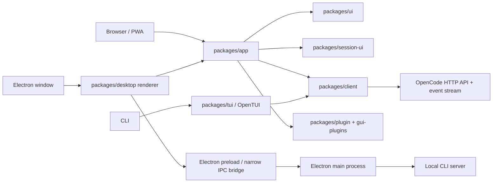

# OpenCode Frontend Architecture (AWMate Reference)

This document maps the frontend in the current AWMate checkout. It is a source-level guide for deciding where an AWMate UI change belongs and how it reaches the user. The AWMate-specific UI changes made so far are summarized in `AWMATE_CHANGELOG.md`; implementation details remain in the source files.

## Executive map

### AWMate UI customizations

- The Windows titlebar uses Back, Forward, Sidebar, File, Edit, View, and Help controls. Menu sizing leaves room for labels and keyboard shortcuts.
- Vertical side tabs can be organized into project folders with session threads nested underneath. This remains controlled by the existing `Organize vertical sidebar` preference, which defaults to `Projects` for new profiles. In project mode, the duplicate flat tab list is hidden.
- The sidebar footer shows an AWMate local-workspace account row. Its menu exposes only Settings and Help.
- The Home navigation row and duplicate Home-page Settings/Help links were removed. The Home route remains the app's startup and empty-state route.

The frontend is not one renderer. It consists of a browser/Desktop GUI, a terminal UI, shared design and conversation packages, and an Electron host:

| Area | Package | Responsibility |
|---|---|---|
| Product GUI | `packages/app` | Main SolidJS application shared by the web UI and the Electron renderer. Owns routes, shell, settings, home, composer, session screen, server state and platform-neutral frontend behavior. |
| Shared controls and design system | `packages/ui` | Reusable Solid components, semantic theme tokens, typography, icons, dialogs, menus, forms, layout, motion, and UI contexts. |
| Shared session presentation | `packages/session-ui` | Conversation timeline, messages, Markdown, tool results, attachments, diffs, file previews, review/comment UI, and related presentation state. |
| Native Desktop host | `packages/desktop` | Electron main process, secure preload bridge, renderer bootstrap, app window, native OS actions, Desktop persistence, and local CLI sidecar lifecycle. |
| GUI extension surfaces | `packages/gui-plugins` and `packages/plugin` | Host and render built-in or configured GUI plugins, panels, browser/terminal/editor tools, and plugin-to-app APIs. |
| Terminal UI | `packages/tui` | OpenTUI-based CLI interface. It is a distinct terminal renderer, not the browser GUI rendered in a terminal. |
| Documentation/site | `packages/web` and `services/site` | Astro-based website/documentation/site code. This is distinct from the OpenCode product GUI in `packages/app`. |

The primary GUI dependency direction is:



## 1. GUI startup and rendering

### Browser and PWA

`packages/app/src/entry.tsx` is the browser entry point. It loads renderer polyfills and the initial locale, creates the web `Platform`, optionally initializes Sentry, and renders the Solid application into `#root`.

At startup it:

1. Determines the server URL. Production normally uses the page origin; Vite development uses `VITE_OPENCODE_SERVER_HOST` and `VITE_OPENCODE_SERVER_PORT` (defaults documented by the app are `localhost:4096`). A build can use `VITE_OPENCODE_SERVER_MODE=none` to start without an initial server.
2. Reads an optional `auth_token` from the URL, converts it into client authentication data, and removes the token from browser history immediately.
3. Detects standalone/PWA mode, restores the saved route if applicable, and registers the service worker in production where supported.
4. Supplies `PlatformProvider`, `AppBaseProviders`, and `AppInterface`; if a server URL was supplied, it becomes the initial canonical HTTP server.

The browser platform implementation is in `packages/app/src/runtime/platform/web.ts`; PWA and keyboard-safe-area behavior live beside it under `runtime/platform`.

### Electron Desktop

The Electron renderer starts at `packages/desktop/src/renderer/index.tsx`. It composes the Desktop app around the shared app package rather than implementing a second copy of the product UI.

The renderer path is:

1. `packages/desktop/src/preload/index.ts` exposes a limited `window.electron` bridge through Electron `contextBridge`; it does not expose Node.js directly to the renderer.
2. `packages/desktop/src/renderer/api.ts` implements the typed `ElectronAPI` on top of the MessagePort-based IPC client.
3. `DesktopApp` creates a Desktop `Platform`, a memory router, and a startup state machine. It hydrates locale/window information, waits for the local sidecar, and handles first-launch onboarding and migration status.
4. Once ready, Desktop supplies the sidecar and any GUI-plugin servers to the same `AppInterface` used by the browser GUI.

The renderer should reach the Electron main process only through `window.electron`/the typed IPC client. Main-process handlers are composed in `packages/desktop/src/main/ipc.ts`; native work belongs in `packages/desktop/src/main/ipc-handlers/*` or the relevant main-process service. The main process owns window creation, menus, filesystem pickers, notifications, logging, crash reporting, Desktop storage, and the background CLI service.

Important Desktop boundaries:

- `packages/desktop/src/renderer/platform/*` adapts native functions into the app’s `Platform` interface.
- `packages/desktop/src/main/service/*` resolves and starts the CLI sidecar.
- `packages/desktop/src/main/storage/*` owns Desktop-only settings, drafts, and renderer state storage.
- `packages/desktop/src/renderer/desktop-app.tsx` owns the Desktop startup machine and sidecar connection; route content remains in `packages/app`.

### Provider composition

`packages/app/src/app.tsx` has two shared composition layers:

- `AppBaseProviders`: document metadata/title, font, theme, language and UI i18n bridge, global error boundary, TanStack Query, dialogs, plugin root, and file-component registration.
- `AppInterface`: server registry, settings, router, and the persistent app shell root. Its root provides tabs, global per-server controllers, project icons, command registration, Desktop commands, voice UI, routes, and the voice overlay.

This keeps most application UI mounted across route changes and lets browser and Desktop differ through platform adapters instead of duplicated feature screens.

## 2. Routes and major product surfaces

The route table is `packages/app/src/shell/routes/routes.tsx`:

| Route | Main owner | Purpose |
|---|---|---|
| `/` | `packages/app/src/home` | Home: projects/workspaces, recent sessions, search, and utility navigation. |
| `/settings` | `packages/app/src/settings` | Settings shell and feature pages, including appearance, keybinds, providers/models, and app configuration surfaces. |
| `/server/:serverKey/session/:id` | `packages/app/src/session` | A session attached to a specific server and session ID. Uses server health/auth gates and lazily loads the session screen. |
| `/new-session` | `packages/app/src/new-session` | A persisted draft tab with workspace/location selection, model selection, composer state, and submit-to-session behavior. |
| `/components` | components lab | Development-only, and included in Beta as a lazy-loaded lab; it is not part of the production route surface. |

The app shell (`packages/app/src/shell/shell.tsx`) provides the titlebar, tabs/sidebar, responsive panels, command palette, dialogs, notifications, plugin slots, and route layout. Home is assembled from controllers and regions rather than a single monolithic component. Session and draft routes add the correct server, workspace/location, file, model, composer-persistence, and session-UI providers.

### Session screen and shared transcript

The app-owned session screen (`packages/app/src/session`) coordinates the session identity, timeline interaction/search, composer, file dropzone, responsive panels, side/bottom plugin regions, review actions, and session layout. The visible conversation pieces are largely delegated to `@opencode/session-ui`:

- timeline projection/rows and message rendering;
- streaming Markdown, code, images, files, attachments, and links;
- tool status/output and grouped tool presentations;
- diff/file review and line comments;
- shared session contexts and story fixtures.

This is the right separation for an AWMate change: app-specific workflow and screen layout generally belong in `packages/app`; reusable transcript rendering belongs in `packages/session-ui`; generic inputs/dialogs/buttons/theme belong in `packages/ui`.

## 3. Frontend data and event flow

### Server registry and per-server controllers

`packages/app/src/runtime/server/registry.tsx` models the available server connections:

- `Http`: a normal web/server URL plus optional saved credentials;
- `Sidecar`: the Desktop app’s managed local server;
- `Plugin`: a server contributed by a Desktop GUI plugin, potentially not ready yet or reconnectable.

The registry stores server metadata and client-local choices such as hidden/visible servers and recently used projects. `GlobalProvider` in `runtime/server/runtime.tsx` creates one controller per server key and disposes/replaces it through a state machine. `ServerProvider` scopes route content to one selected server and shows signed-out UI when its credentials are rejected.

### Requests, streaming events, and reactive data

For each server, `runtime/server/client.tsx` creates an API transport using `@opencode/client/solid`, owns request cancellation and connection/reconnect state, and exposes a typed event source. This gives the UI:

1. Typed HTTP/API methods for reads and actions.
2. A persistent server event stream for live updates.
3. Per-server and per-location scopes so data from different servers/projects does not get mixed.
4. Reconnect handling for a sidecar or plugin whose endpoint can change.

The server controller combines client data stores, TanStack Solid Query, bootstrap/config/path/project loading, worktree inventories, and event synchronization (`runtime/server/sync.tsx`). Server events update or invalidate the corresponding local query/store state; Solid then updates the affected UI. The backend/server remains the durable source for sessions, messages, project data, providers, and tool state. The frontend holds reactive/cache projections, not the authoritative conversation database.

Typical action loop:

```text
User action
  -> feature controller / UI state machine
  -> typed @opencode/client API request
  -> OpenCode server
  -> response and/or server event stream
  -> scoped data/query state update
  -> Solid reactive render
```

### Client-side persistence

`packages/app/src/runtime/persistence` is a separate UI-state persistence system. It is not the server session database.

- `persisted()` validates stored values through Effect Schema codecs and exposes a Solid store.
- Browser preferences use browser storage; Desktop uses namespaced storage backed by the main process and synchronized across windows.
- Saves are batched and flushed on page/window lifecycle events.
- Draft documents and attachment blobs use a dedicated async draft store. Browser storage is IndexedDB-backed; Desktop storage is hosted by the Electron main process in SQLite. Large text and binary attachments are externalized into blobs rather than repeatedly copying large payloads into one setting.
- Cross-window updates, migrations, quota/error recovery, flushes, and draft blob lifetimes are explicit state machines.

The detailed persistence contract is documented in `packages/app/src/runtime/persistence/README.md`.

## 4. Shared UI, themes, fonts, and localization

### `packages/ui`

This is the general-purpose Solid component and design-system package. Its source is grouped by semantic role: actions, forms, overlays, navigation, layout, typography, icons, feedback, data display, hooks, theme, and contexts. It exports public component entry points through `packages/ui/package.json`.

Use it for generic controls and shell primitives. Avoid copying an existing control into `packages/app` or using raw color values where a semantic token exists.

### Theme system

Theme schemas, built-in themes, light/dark resolution, and CSS variable generation live in `packages/ui/src/theme`. The UI styles import semantic token layers from `packages/ui/src/styles/tokens`. Runtime theme selection is applied by `ThemeProvider`; the HTML also has a small theme preload so the page background can be correct before the full Solid app mounts.

Theme tokens express semantic roles such as background, text, action, form field, icon, and feedback. AWMate should add a new semantic token if no existing role fits rather than repurposing a similarly colored token.

### CSS and typography

- `packages/ui/src/styles/index.css` imports Tailwind, reset/base rules, shared component CSS, tokens, scrollbars, and shared animations/utilities.
- `packages/app/src/index.css` layers app and session-ui styles on top of the shared UI system and owns the shipped font faces.
- Desktop adds renderer/window styles in `packages/desktop/src/renderer/styles.css`.
- Keep text font choices semantic and user-configurable through the UI/code/terminal font roles; do not add isolated font declarations in feature files.

### Localization

The app’s typed language provider and English source dictionary are under `packages/app/src/runtime/i18n`. Desktop-native strings have a typed bundle used by the main process. New user-visible copy must use the language API and add English source strings; avoid hard-coded strings in components. Count-sensitive messages use the shared plural API, not hand-built locale branching.

## 5. Platform abstraction and Desktop native integration

`packages/app/src/runtime/platform/platform.tsx` defines a capability-oriented platform interface. It covers common actions such as opening external links, restart, notifications, storage, drafts, and fetch, with optional Desktop capabilities such as file pickers, local paths, clipboard, native menu actions, zoom, spellcheck, window state, and plugin bridges.

The web adapter implements only browser-safe behavior. The Desktop adapter composes native services from `packages/desktop/src/renderer/platform/*` and calls `ElectronAPI`. This boundary lets shared screens use platform capabilities without importing Electron or Node modules.

For new AWMate UI work:

- put shared visual workflows in `packages/app`;
- add a capability to the platform contract only when both the shared app and a platform adapter need it;
- keep Electron APIs, filesystem access, and native dialogs in Desktop main/preload/platform code;
- pass data through typed IPC and validate at that boundary.

## 6. GUI plugins

The GUI plugin system is distinct from the core screen tree but integrates with it through explicit hosts and slots:

- `packages/plugin` defines the plugin-facing contracts and host bridge;
- `packages/gui-plugins` contains built-in Desktop GUI features and plugin surfaces;
- `packages/app/src/runtime/plugin` attaches plugin-provided servers, routes, links, panels, and screen regions to the app;
- Desktop main-process plugin hosting and renderer plugin bridging live in `packages/desktop/src/main/plugin` and `packages/desktop/src/renderer/plugins.ts`.

Use plugin slots for genuinely extensible panels or tools. Core AWMate workflow should remain in app feature modules unless it needs to be independently enabled, extended, or supplied by a plugin.

## 7. Terminal UI is a separate frontend

The CLI default command resolves a server and calls `run()` from `@opencode/tui` (`packages/cli/src/commands/handlers/default.ts`). The TUI is built on `@opentui/core` and `@opentui/solid`, with terminal-specific routes, contexts, keymaps, dialogs, prompt editor, theme, and renderer. It consumes the same backend/client concepts but has its own component and interaction system.

Consequences:

- A Desktop/Web visual change in `packages/app` does not automatically change the terminal UI.
- A TUI-only change belongs in `packages/tui` and follows its separate story and terminal test workflow.
- Shared behavior or protocol changes can affect both frontends, but each renderer still needs its own UI implementation.

## 8. Build, run, and verification entry points

Current root scripts and package manifests show:

| Goal | Command | Notes |
|---|---|---|
| Run CLI/TUI from source | `bun run dev` from repository root | Uses `packages/cli`; isolate XDG roots when testing so CLI state does not share installed OpenCode state. |
| Run web product GUI | `bun run dev:web` from repository root, or `bun dev -- --port 4444` inside `packages/app` | Start a backend separately at port 4096 when following `packages/app/AGENTS.md`; the GUI dev server targets that API. |
| Run Desktop app from source | `bun run dev:desktop` from repository root | Builds the app renderer and launches Electron with the local CLI sidecar. For isolated testing use `OPENCODE_DESKTOP_TEST_ROOT`; ensure the real Bun executable is discoverable by child processes on Windows. |
| Build web GUI | `bun --cwd packages/app build` | Emits static GUI assets for hosting/embedding. |
| App unit/browser tests | `bun run test:unit` / `bun run test:browser` in `packages/app` | E2E/component suites have their own scripts and Playwright configs. Do not run root `bun test`; it is intentionally blocked. |
| Component stories/tests | package-specific Storybook/Playwright workflows in `packages/ui`, `packages/session-ui`, and `packages/stories` | Prefer the owning package’s story or component suite. |
| TUI live against installed service | `bun run dev:live` from a development worktree | Intentionally uses the elected installed server/live sessions; do not use when an isolated server/data test is required. |

The root package pins Bun `1.4.4`; use the pinned version for consistent dependency resolution. `packages/app/README.md` contains generic template material in places, so follow `packages/app/AGENTS.md` and the current scripts for this checkout’s actual local-development workflow.

## 9. Frontend technology versions in this checkout

These are manifest/lockfile declarations at the inspected source revision, not claims about the latest upstream releases:

| Technology | Declared version / source |
|---|---|
| SolidJS | `1.9.17` via root workspace catalog |
| Solid Router | `1.0.0` via root workspace catalog |
| TanStack Solid Query | `5.91.4` in `packages/app` |
| Vite for app/desktop | `8.2.4` in `packages/app` and `packages/desktop` |
| Vite Solid plugin | `2.11.14` in `packages/app` |
| Tailwind CSS and Vite plugin | `4.3.3` in `packages/app` |
| Electron | `44.9.1` in `packages/desktop` |
| electron-vite | `6.0.0-beta.1` in `packages/desktop` |
| OpenTUI core/Solid | `0.8.1` via the workspace catalog for `packages/tui` |

The repo uses Bun workspaces and package-local dependency overrides; do not infer the app’s versions from the root catalog alone where the app package pins a different version.

## 10. Recommended AWMate frontend change map

| AWMate change | Start in |
|---|---|
| New shared product screen or workflow | `packages/app/src/<feature>`; add route only if it is a top-level navigable screen. |
| Home/project/session navigation | `packages/app/src/home` or `packages/app/src/shell` |
| Prompt/composer workflow | `packages/app/src/composer` and, when it is a reusable session transcript component, `packages/session-ui` |
| Timeline, message, tool output, Markdown, file/diff rendering | `packages/session-ui` |
| Generic button/dialog/menu/form/theme token | `packages/ui` |
| Native file picker, menu, notification, clipboard, app lifecycle | `packages/desktop` main/preload/platform, exposed through the `Platform` boundary |
| Extensible side panel or plugin-contributed server | `packages/plugin`, `packages/gui-plugins`, and the app plugin host/slot |
| CLI terminal experience | `packages/tui` |
| API-backed new capability | Confirm the backend API/schema/client contract first; the GUI should call the typed client instead of reaching into server internals. |
| Product name, icons, Desktop application identity | App assets/metadata plus Desktop channel constants and packaging configuration; this checkout currently still carries OpenCode branding in several of these locations. |

For every AWMate-specific divergence, use a focused Git commit and a selective `// AWMate customization:` comment where the reason is important for future upstream merges. Do not add a comment to every changed line; Git history and PR diffs remain the source of truth.

## 11. Rules that materially affect frontend work

The package guidance checked for this map is in `packages/app/AGENTS.md`, `packages/ui/AGENTS.md`, `packages/session-ui/AGENTS.md`, `packages/desktop/AGENTS.md`, and `packages/tui/AGENTS.md`. Key constraints:

- Lifecycle behavior should be represented by a discriminated state machine, a pure transition, and a thin effectful driver; avoid side booleans that also encode the phase.
- Guard async Solid resources by their loading state; unguarded reads can suspend/blank a screen during refresh.
- Prefer Solid `createStore` for grouped mutable UI state.
- Use semantic theme tokens, shared font roles, shared loading indicators, and shared scroll primitives.
- Add user-visible English strings through i18n.
- For plain HTTP LAN origins, use `uuid()` from `@opencode/util/uuid` instead of secure-context-only `crypto.randomUUID()`, and guard other secure-context-only browser APIs.
- Keep session/timeline hot paths simple and benchmark changes against `origin/dev` with the prescribed strobe benchmark before modifying timeline/session performance-sensitive behavior.
- Tests should protect observable contracts, have one owner, and run from the owning package, not the repository root.
- Desktop renderer must use the preload/API bridge; keep native behavior out of shared app code.

## 12. Current AWMate baseline and limits of this analysis

The inspected checkout is the OpenCode `2.2.5` source tree with AWMate repository/workflow documentation. The checked-in Desktop constants still label the app `OpenCode Dev` and use OpenCode Desktop channel IDs; the app title, favicons, manifests, and packaged identity also need a coordinated AWMate branding pass before shipping an AWMate build. No frontend source code was changed during this analysis, and no tests or builds were run.
